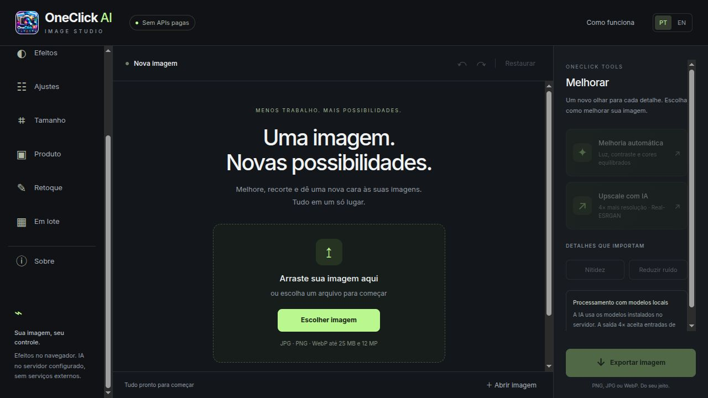

<div align="center">


# OneClick AI — Image Studio

**Melhore, recorte e transforme imagens. Sem APIs de IA pagas.**  
**Enhance, cut out and transform images. No paid AI APIs.**

[Abrir aplicativo / Launch app](https://4u.ia.br/app/oneclick/) · [4u-Labs](https://github.com/4u-Labs) · [Apoiar / Support](https://www.paypal.com/ncp/payment/L7YRCS984T33N)
</div>



## Português

OneClick AI reúne ferramentas rápidas de imagem em uma interface bilíngue PT/EN. O frontend usa HTML, CSS e JavaScript puro, sem etapa de build. Efeitos e retoques são processados no navegador; remoção neural de fundo e ampliação usam modelos executados no backend da aplicação.

### Recursos

- **Remover fundo:** U²-Net, recorte por cor conectado às bordas e modo automático com seleção manual de método.
- **Upscale 4×:** Real-ESRGAN, com preservação do canal alfa e processamento em blocos.
- **Efeitos rápidos:** preto e branco, sépia, vintage, negativo, duotone, pôster e lápis.
- **Ajustes:** brilho, contraste, saturação, temperatura, nitidez e redução simples de ruído.
- **Produto e adesivos:** composição quadrada, margem, sombra, contorno, fundos sólidos/degradês e imagem personalizada.
- **Retoques:** apagar/recuperar partes do recorte, clonagem, correção local de pequenas manchas, desfoque e efeitos por região.
- **Tamanho e composição:** cortar, redimensionar proporcionalmente, girar, espelhar e adicionar marca-d’água em texto.
- **Comparação e histórico:** divisor interativo, lado a lado, zoom, desfazer/refazer e restaurar.
- **Em lote:** até 20 imagens, processamento sequencial e resultados em ZIP.
- **Exportação:** PNG, JPG e WebP, com controle de qualidade quando aplicável.
- **PWA:** instalação em navegadores compatíveis, cache isolado e editor disponível offline após o primeiro carregamento completo.

### Privacidade e limites

Efeitos e retoques comuns permanecem no navegador. Os recursos de IA enviam a imagem atual ao servidor configurado, onde os modelos são executados; não usam APIs externas de IA. Arquivos temporários do backend são removidos ao finalizar a operação. O histórico de edição fica em memória: exporte antes de fechar ou atualizar.

O cache PWA não inclui imagens do usuário, modelos ou respostas da API. **A IA exige acesso ao backend**, mesmo com o PWA instalado. Não há login obrigatório nem chaves de API para usar o app.

Entrada individual: até 25 MB e 12 MP. Upscale: até 1,5 MP de entrada, 4× em cada dimensão. Saída geral: até 24 MP. Lote: até 20 imagens e 100 MB de entrada. Correção de manchas usa interpolação local, não preenchimento generativo; fundos complexos podem exigir retoque manual. LaMa e GFPGAN não estão integrados.

### Executar localmente

Requisitos: Python 3.10+ com suporte às dependências de `requirements.txt`.

```bash
git clone https://github.com/4u-Labs/oneclick.git
cd oneclick
python3 -m venv .venv
.venv/bin/python -m pip install -r requirements.txt
```

Para habilitar a IA, baixe os dois modelos ONNX da [release v1.0.0](https://github.com/4u-Labs/oneclick/releases/tag/v1.0.0), coloque-os em `models/` e confira os hashes em [MODELS.md](MODELS.md). Os efeitos no navegador funcionam sem os modelos.

```bash
ONECLICK_PYTHON="$PWD/.venv/bin/python" bash start.sh
```

Abra **http://127.0.0.1:8775/** e mantenha o terminal aberto. Para outra porta, use `bash start.sh 8776` com o mesmo Python configurado. O servidor local escuta somente em `127.0.0.1` e não deve ser usado como servidor público.

### Hospedar com PHP e Python

Publique o frontend estático e `api/process.php` em um servidor com PHP 8.3 e Python com as dependências instaladas. Configure `ONECLICK_PYTHON` para o ambiente Python; o backend também reconhece um ambiente existente em `/opt/ai_upscaler/upscale_env/bin/python`.

PHP precisa de `proc_open`, acesso de leitura aos modelos e permissão de criar temporários. Configure o proxy/PHP com timeout superior a 240 segundos e limite de corpo de 32 MB. A inferência é limitada a uma operação por vez.

**Proteja `models/` e os scripts `.py` contra acesso HTTP.** O `.htaccess` é para Apache; no Nginx use [docs/nginx-oneclick.conf](docs/nginx-oneclick.conf) como referência e adapte o socket/porta PHP ao seu servidor. Valide a configuração antes de recarregar. Não publique ambientes virtuais, logs ou arquivos privados.

## English

OneClick AI is a bilingual PT/EN image studio built with plain HTML, CSS and JavaScript, with no build step. It combines AI background removal and 4× upscaling with browser-based effects, color adjustments, cropping, resizing, product layouts, stickers, text watermarks and batch ZIP export.

Retouch tools include erase/recover brushes, cloning, local spot interpolation, selective blur, and regional black-and-white/sepia effects. Compare the original and current versions with a divider or side-by-side view; undo and redo edits before exporting PNG, JPG or WebP.

### Processing and privacy

Standard effects and retouching run in your browser. AI tools send the current image to the configured application backend, which runs U²-Net and Real-ESRGAN without paid third-party AI APIs. Temporary processing files are deleted after each request. **AI tools require a reachable backend.** Installing the PWA does not make server inference available offline.

The PWA caches only the editor shell and icons, excluding user images, models and API responses. Export your work before closing the page: editing history is held in memory.

Limits: 25 MB / 12 MP per input image; AI upscaling accepts up to 1.5 MP and scales each dimension by four; batch input supports up to 20 images / 100 MB. Spot healing is local interpolation, not generative inpainting. LaMa and GFPGAN are not included.

### Local setup

Use the commands in the Portuguese section above: clone the repository, create a Python virtual environment, install `requirements.txt`, place the release ONNX files in `models/`, and start the app with `ONECLICK_PYTHON` pointing to that environment. Open **http://127.0.0.1:8775/**. Browser effects work without neural models.

For production, use a proper static/PHP web server and Python runtime. Block direct HTTP access to models and Python scripts; see the Nginx example. Keep the local development server private.

## Modelos, créditos e licenças / Models, credits and licenses

- [U²-Net](https://github.com/xuebinqin/U-2-Net): Apache 2.0; included notice in `licenses/U2NET-APACHE-2.0.txt`.
- [Real-ESRGAN](https://github.com/xinntao/Real-ESRGAN): BSD 3-Clause; included notice in `licenses/REALESRGAN-BSD-3-CLAUSE.txt`.
- ONNX Runtime, Pillow and NumPy retain their respective licenses.
- Model binaries are release assets, not Git history. See [MODELS.md](MODELS.md).

Desenvolvido por **Fabiano Braga — 4U.IA.BR**.  
[Portal](https://4u.ia.br/) · [GitHub](https://github.com/4u-Labs) · [Blog](https://4u-labs.github.io/) · [Ajuda / Help](https://4u.ia.br/suporte.html) · [Apoiar / Support](https://www.paypal.com/ncp/payment/L7YRCS984T33N)
